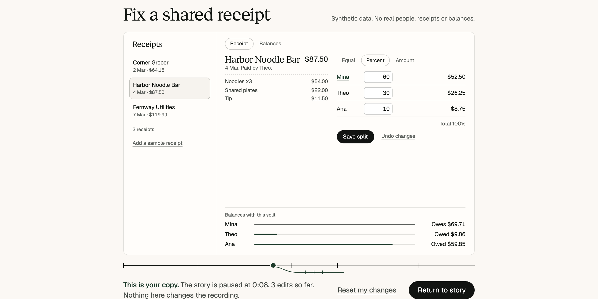

# Reel

Reel is a local editor for product demos that stay interactive. You record a workflow from
a React scene, add chapters and captions, and export a static page. A viewer can pause it,
scrub it, press **Take over** to use the product from that exact moment, then return to your
story at a chapter.



**[Try the live demo](https://www.qendrimbeka.com/projects/reel/)**, watch the
[18 second demo](docs/media/demo.mp4), or see the
[63 second walkthrough](docs/media/walkthrough.mp4), which is silent with on-screen notes.

## Quick start

You need Node 22 and pnpm 12. If you have Node, `corepack enable` gives you the right pnpm.

```bash
git clone https://github.com/qbeka/reel-studio.git
```

```bash
cd reel-studio && pnpm install --frozen-lockfile
```

Run a finished demo, then open <http://127.0.0.1:4173/projects/reel/>.

```bash
pnpm demo
```

Or open the editor on port 5174.

```bash
pnpm dev
```

## What it does

Reel records semantic commands that a scene declares, such as `setSplit`, with their logical
time. It does not record pixels, DOM changes or mouse paths, so playback is the real
application running and a viewer can take over at any moment.

- **Seek anywhere.** Reel restores a checkpoint and replays to the exact time. The timeline
  is cut into the chapters you named, and each name jumps to its chapter.
- **Look without going.** Hover the timeline and Reel works out the state at that moment
  and runs the app on it, small. No thumbnail is stored. Beside it is a list of the values
  that differ from the moment on screen.
- **Compare two moments.** Compare holds one moment. Wherever the story goes next, every
  value that differs from it is listed, and outlined in the app itself.
- **Watch it like a demo.** The app sits in a window, the camera closes in on the part in
  use and quiets the rest, a pointer reaches for each control, typed values arrive a key at
  a time, and captions are set under the picture like subtitles. Reel records no pointer
  movement and no key presses, so the pointer and the typing are drawn from the commands,
  and it says so.
- **Take over.** The state on screen becomes the viewer's own copy. The drawn pointer goes
  to the viewer's real one, the window changes colour, and the viewer's line runs beside the
  recording on the same time scale. What changed lists how far the copy has come from it.
- **Return.** Back to demo restores the recorded moment and keeps the viewer's copy one press
  away, and Choose a moment offers the chapters. States are never merged, and nothing a
  viewer does reaches the recording, the URL or storage.
- **Edit safely.** If you remove a command that later ones need, Reel shows what breaks and
  will not save a recording that cannot play.
- **Export a folder.** It runs on any static host, under any path, with a plain transcript
  and a poster for embedding. See [docs/EMBED.md](docs/EMBED.md).

Reel works with scenes you register at build time. It cannot record arbitrary websites. For
that, use a tool like [rrweb](https://github.com/rrweb-io/rrweb).

## Results

| | |
|---|---|
| **Seek** | p95 23 ms on a generated 20,000 command log, against 1,130 ms replaying from the start. On a real 10 command recording there is no gain: 3.5 ms with checkpoints and 3.1 ms without. |
| **First seek** | About 1.3 s at worst on that same log, in a fresh page. The page appears in 144 ms. |
| **Correctness** | 0 mismatches against replay at 5,332 positions. An independent model of each scene agreed on every log. |
| **Test quality** | 14 of 14 seeded failures caught. 36 of 38 mutants killed, 2 equivalent. |
| **Viewer size** | 115 KB of JavaScript and CSS with gzip. It needs no backend. |

Measured on 10 November 2026 (UTC) on one Apple M5 Pro laptop in headless Chromium, with other
work running. The mutants are from the run of 6 November, because the code they change has
not changed. These are lab numbers. [What they leave out](docs/REPORT.md#what-the-headline-leaves-out).

## Add a scene

A scene is an adapter with a seed, a reducer and a React renderer.

```ts
export const counterAdapter: SceneAdapter<CounterState> = {
  id: 'counter',
  version: 1,
  commandTypes: ['add'],
  targets: [{ id: 'total', label: 'Total' }],
  init: (seed) => ({ total: 0, rng: seed }),
  parse: (type, payload) => (Number.isInteger(payload.by) ? null : 'add needs a whole number.'),
  precondition: () => null,
  apply: (state, command) => ({ ...state, total: state.total + (command.payload.by as number) }),
  // Plus title, summary, layouts, serialize, restore, describe, targetOf and Render.
};
```

Then add one entry to [src/scenes/registry.ts](src/scenes/registry.ts) and one line to
`src/styles/scenes.css`. [docs/FORMAT.md](docs/FORMAT.md) is the full contract. Two scenes are
included, each drawn as an invented product: Tabkin, a receipt splitter, and Relaymoth, a
delivery console over a retry queue with seeded backoff. The project page plays both.

## Export from the command line

```bash
pnpm export projects/receipt-split-release.reel.json --out exports/receipt
```

```bash
pnpm exec tsx scripts/verify-bundle.ts exports/receipt
```

The second command checks every file hash and replays the story against the manifest.

## Test it

Run types, lint and the copy check.

```bash
pnpm check
```

Run the unit tests, including the oracles, fuzz tests and negative controls.

```bash
pnpm test
```

Run the browser tests. Chromium runs all 133. WebKit and Firefox repeat the 47 exported viewer
and project page tests. On a Mac, keep the display awake, or WebKit clicks fail.

```bash
pnpm exec playwright install chromium webkit firefox
```

```bash
pnpm test:e2e
```

## Measure it

A quick engine timing, in about 30 seconds.

```bash
pnpm bench:smoke
```

The full protocol, in about 15 minutes.

```bash
pnpm bench
```

## Read more

| Document | Contents |
|---|---|
| [docs/REPORT.md](docs/REPORT.md) | Results, limits, what failed and what changed. |
| [site/](site/) | The project page. It runs the viewer directly on both demos, with an authoring panel for chapters, captions and the camera, and figures drawn from the recording and the measured run. Build it with `pnpm build:site`. |
| [docs/ARCHITECTURE.md](docs/ARCHITECTURE.md) | How seeking, branches and export work. |
| [docs/FORMAT.md](docs/FORMAT.md) | The adapter contract and project file. |
| [docs/DESIGN.md](docs/DESIGN.md) | The central workflow and the design that was rejected. |
| [docs/EMBED.md](docs/EMBED.md) | Hosting and embedding. |
| [docs/RESEARCH.md](docs/RESEARCH.md) | Sources and pinned versions. |
| [bench/PROTOCOL.md](bench/PROTOCOL.md) | How the numbers are measured. |

## License

MIT for the code here. Fonts and React keep their own licenses. See [NOTICE.md](NOTICE.md).
Tabkin, Relaymoth and their data are invented, and this project holds no Koba code or data.
